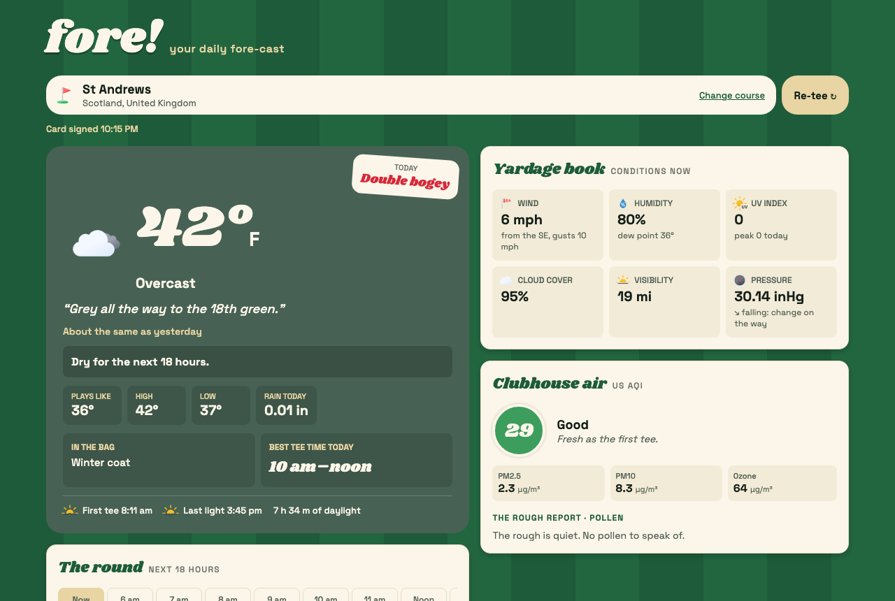
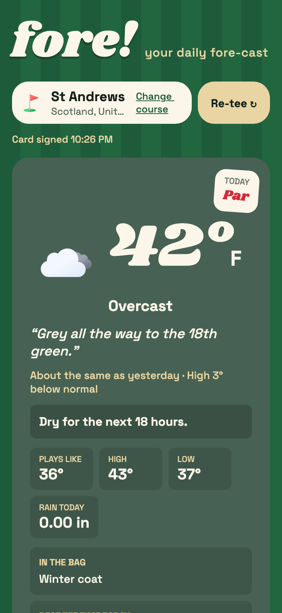
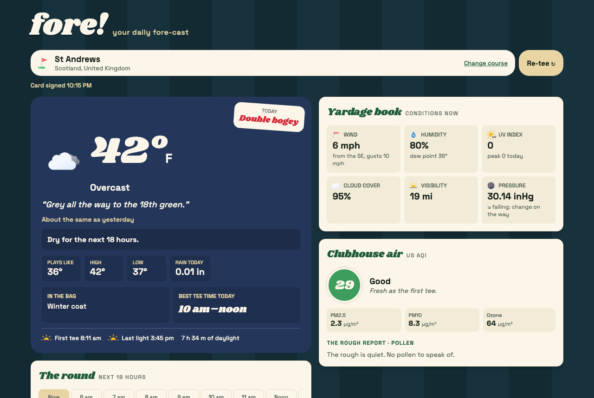
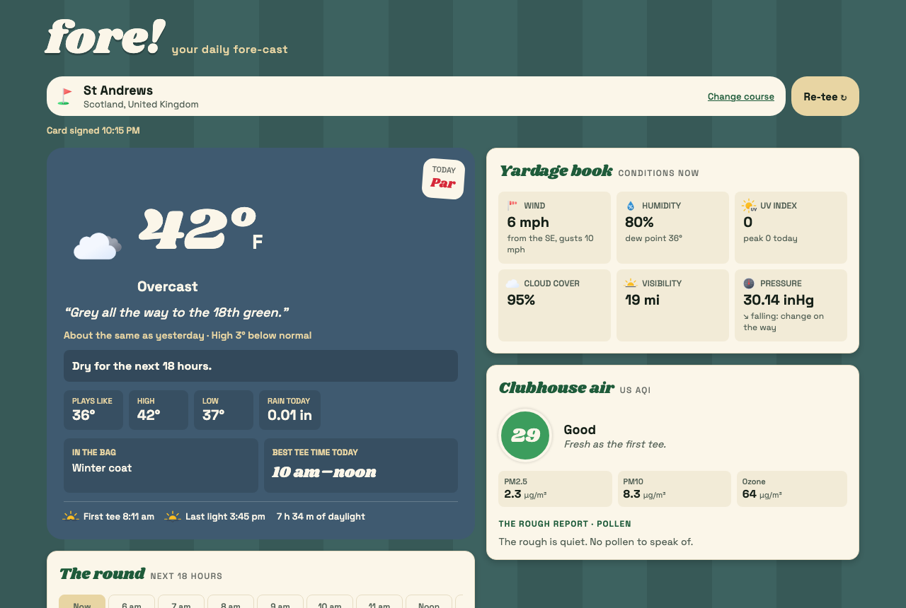
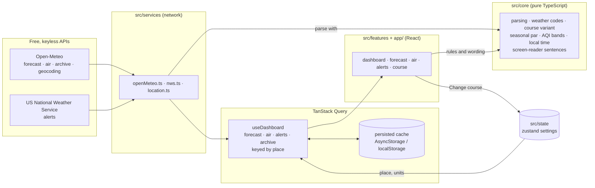

# fore!

[](https://github.com/nwangemann/fore/actions/workflows/check.yml)

A small, cheeky weather dashboard for one home course, with golf jokes. Built with Expo for the web first.

<p>
  
  
</p>

fore! turns a free weather API into a golfer's fore-cast. It reads the sky for the place you call home, tells you whether today is under or over par for getting outside, which hour is the best tee time, what goes in the bag, and whether the air or a weather warning should keep you in the clubhouse. It runs in the browser with no account and no API key, remembers your course, and paints your last forecast instantly while it fetches a fresh one. The whole page changes with the weather: mown stripes by day, a night course after sunset, frost in snow, storm in thunder.

<p>
  
  
</p>

## Features

- **Now:** temperature, "plays like", conditions with a quip, vs yesterday and vs normal, a rain outlook and 15-minute nowcast, what's in the bag, the best tee time, caddie notes, sunrise and sunset.
- **The round:** the next 18 hours, split at the turn after nine.
- **Scorecard:** seven days, each scored against a seasonal par, with the best day to play.
- **Yardage book:** wind and gusts, humidity and dew point, UV, cloud, visibility, and pressure with its 3-hour trend.
- **Clubhouse air:** US AQI with a heads-up when the next 24 hours get worse, particulates and ozone, plus pollen where the model has it (Europe).
- **FORE! banners** for active US National Weather Service alerts, most severe first.
- **Change course:** place search, "Use my location", recent places, imperial or metric units. Saved in the browser.
- **Errors never render blank:** an "Out of bounds" card with a Re-tee button for failures, and a cached dashboard that says "couldn't refresh" or "offline".
- **Accessible:** keyboard-only use with visible focus rings, one screen-reader sentence per hour and per day, and every text colour pair at WCAG AA in every course variant.

## Stack

Expo SDK 58 and Expo Router (web first; iOS and Android build from the same code but are untested), React 19, React Native Web, TypeScript, TanStack Query with a persisted cache, zustand, react-native-svg with vendored Meteocons icons. Jest (`jest-expo`) and Playwright for tests, ESLint, Prettier, Husky and commitlint, GitHub Actions for CI.

## Architecture



`src/core` has no React or Expo imports, so the rules are plain functions with unit tests. Services fetch and parse; `useDashboard` composes one query per source, every key carrying the place, so switching course never shows the old course's data. More in [docs/architecture.md](docs/architecture.md) and the [decision records](docs/adr/).

## What's interesting

- **Seasonal par** ([ADR 6](docs/adr/0006-seasonal-par.md)). A fixed "nice day" put every November day over par. Par is now a normal day for this place and week: ten years of Open-Meteo archive data, fetched once per place per year. Warmer, drier and calmer than normal is under par; it never goes under par below 5 °C or above 35 °C, and thunderstorms are a weather delay.
- **Place-local time.** Open-Meteo returns the course's wall-clock times with no offset. `src/core/weather/localTime.ts` reads them as text, so the round and the tee times are right for the course wherever the viewer is.
- **Cache-first loading** ([ADR 8](docs/adr/0008-tanstack-query.md)). The TanStack Query cache is persisted, so a reload paints the last visit at once ("From your last visit · updating…"), data stays fresh for 10 minutes and refetches on focus, a failed refresh keeps the last good forecast, and only a forecast failure is ever shown.
- **Layered tests.** Unit tests in `src/core` where mistakes hide (scoring, outlook, parsing, AQI, speech); service tests against recorded API responses, so a changed field fails a test; and a Playwright smoke test of the web export with the same fixtures, a pinned clock and every outside request blocked.
- **The course follows the weather** ([ADR 11](docs/adr/0011-course-variants.md)). One pure function picks day, night, frost or storm from the current sky; the stripes and hero follow it from the dashboard's own forecast query, so it costs no extra request. Every palette was checked for 4.5:1 contrast.

## Run and test

Needs Node 22.13+, 24.3+ or 26+.

```bash
npm install
```

```bash
npm run web
```

```bash
npm run check
```

```bash
npm run test:e2e
```

`npm run web` serves the dashboard at http://localhost:8081. `npm run check` runs types, lint, formatting, unit and service tests and a docs check. `npm run test:e2e` runs the Playwright smoke test (first time: `npx playwright install --only-shell chromium`). CI runs `check` and `e2e` on every push and pull request. More in [docs/README.md](docs/README.md).

## Built with an AI agent

fore! was built largely by an AI coding agent, steered by project instructions, a skill, ADRs and a backlog of session-sized steps. [docs/ai-workflow.md](docs/ai-workflow.md) explains how, and what was verified by the agent versus left to a person.

## Credits and licence

- Weather, air quality, pollen, seasonal normals and place search by [Open-Meteo](https://open-meteo.com/) (CC BY 4.0; place names from GeoNames).
- Alerts by the [US National Weather Service](https://www.weather.gov/) (public domain).
- Weather icons by [Meteocons](https://github.com/basmilius/meteocons) by Bas Milius (MIT), see [THIRD_PARTY_NOTICES.md](THIRD_PARTY_NOTICES.md).

Sources and terms: [docs/data-sources.md](docs/data-sources.md). fore! is [MIT licensed](LICENSE).
